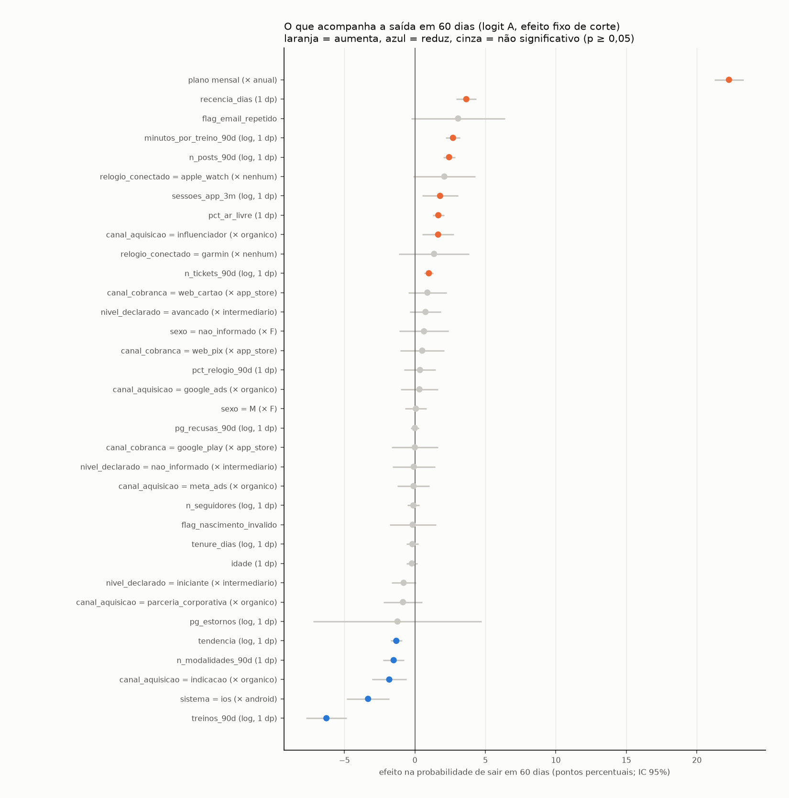

# Churn: efeitos fixos e comparação com a segmentação K-means

Gerado por `src/churn_efeitos_fixos.py`. Entrada: `base_assinantes_painel_rotulado.parquet` (SHA-256 `f59408ac3a478274…`, não alterado). Cruzamento aponta suspeitos, não prova causa: os efeitos abaixo são associações controladas, não efeitos causais.

## 1. Painel

| medida | valor |
|---|---|
| linhas (assinante × corte) | 42.280 |
| assinantes | 15.951 |
| assinantes nos 3 cortes | 12.315 |
| assinantes com saída que varia entre cortes (identificam os efeitos fixos por pessoa) | 1.477 |
| taxa de saída em 60 dias | 12,21% |

Contínuas padronizadas (1 dp no painel; `log` nas contagens assimétricas). Categóricas contra a referência entre parênteses. Idade ausente recebe a mediana e a marca `flag_nascimento_invalido` entra no modelo. `cancelamento_web` só aparece nos eventos a partir de 01/06/2026 (mesma data em que começou a pesquisa de saída): vale só no corte de 30/06 e fica fora do teste fora do tempo. Fora por não variar no painel: `sem_questionario` (todo assinante ativo respondeu) e `n_carencia` (nenhum ativo tinha passado por carência antes do corte: a carência termina em expiração).

## 2. Logit agrupado com efeito fixo de corte (principal)

Erro-padrão agrupado por assinante. Pseudo-R²: A 0,146; B 0,400. Efeito = mudança média na probabilidade de sair (pontos percentuais).

### Especificação A: comportamento e contexto (leitura dos fatores)

| variável | razão de chances | efeito (p.p.) | IC 95% (p.p.) | p |
|---|---|---|---|---|
| plano mensal (× anual) | 10,35 | 22,28 | 21,25 a 23,31 | < 0,001 |
| treinos_90d (log, 1 dp) | 0,52 | -6,28 | -7,73 a -4,82 | < 0,001 |
| recencia_dias (1 dp) | 1,47 | 3,65 | 2,93 a 4,36 | < 0,001 |
| sistema = ios (× android) | 0,71 | -3,32 | -4,82 a -1,82 | < 0,001 |
| flag_email_repetido | 1,38 | 3,06 | -0,26 a 6,39 | 0,071 |
| minutos_por_treino_90d (log, 1 dp) | 1,33 | 2,70 | 2,19 a 3,22 | < 0,001 |
| n_posts_90d (log, 1 dp) | 1,29 | 2,43 | 2,01 a 2,85 | < 0,001 |
| relogio_conectado = apple_watch (× nenhum) | 1,24 | 2,09 | -0,11 a 4,28 | 0,062 |
| canal_aquisicao = indicacao (× organico) | 0,83 | -1,82 | -3,05 a -0,59 | 0,004 |
| sessoes_app_3m (log, 1 dp) | 1,21 | 1,79 | 0,52 a 3,06 | 0,006 |
| pct_ar_livre (1 dp) | 1,19 | 1,66 | 1,25 a 2,07 | < 0,001 |
| canal_aquisicao = influenciador (× organico) | 1,19 | 1,65 | 0,54 a 2,76 | 0,004 |
| n_modalidades_90d (1 dp) | 0,85 | -1,51 | -2,25 a -0,76 | < 0,001 |
| relogio_conectado = garmin (× nenhum) | 1,15 | 1,36 | -1,13 a 3,85 | 0,284 |
| tendencia (log, 1 dp) | 0,87 | -1,32 | -1,72 a -0,91 | < 0,001 |
| pg_estornos (log, 1 dp) | 0,88 | -1,23 | -7,20 a 4,73 | 0,685 |
| n_tickets_90d (log, 1 dp) | 1,11 | 0,99 | 0,67 a 1,31 | < 0,001 |
| canal_cobranca = web_cartao (× app_store) | 1,10 | 0,89 | -0,46 a 2,24 | 0,197 |
| canal_aquisicao = parceria_corporativa (× organico) | 0,92 | -0,85 | -2,23 a 0,53 | 0,230 |
| nivel_declarado = iniciante (× intermediario) | 0,92 | -0,80 | -1,66 a 0,07 | 0,072 |
| nivel_declarado = avancado (× intermediario) | 1,08 | 0,75 | -0,35 a 1,85 | 0,179 |
| sexo = nao_informado (× F) | 1,07 | 0,65 | -1,11 a 2,40 | 0,471 |
| canal_cobranca = web_pix (× app_store) | 1,06 | 0,52 | -1,04 a 2,08 | 0,515 |
| pct_relogio_90d (1 dp) | 1,04 | 0,36 | -0,76 a 1,49 | 0,526 |
| canal_aquisicao = google_ads (× organico) | 1,03 | 0,33 | -1,00 a 1,65 | 0,629 |
| idade (1 dp) | 0,98 | -0,21 | -0,59 a 0,17 | 0,274 |
| tenure_dias (log, 1 dp) | 0,98 | -0,17 | -0,60 a 0,25 | 0,420 |
| flag_nascimento_invalido | 0,98 | -0,15 | -1,80 a 1,49 | 0,854 |
| n_seguidores (log, 1 dp) | 0,99 | -0,11 | -0,53 a 0,31 | 0,617 |
| canal_aquisicao = meta_ads (× organico) | 0,99 | -0,10 | -1,24 a 1,04 | 0,868 |
| nivel_declarado = nao_informado (× intermediario) | 0,99 | -0,08 | -1,60 a 1,43 | 0,916 |
| sexo = M (× F) | 1,01 | 0,07 | -0,70 a 0,84 | 0,858 |
| canal_cobranca = google_play (× app_store) | 1,00 | -0,01 | -1,65 a 1,63 | 0,994 |
| pg_recusas_90d (log, 1 dp) | 1,00 | -0,00 | -0,28 a 0,27 | 0,989 |

### Especificação B: A + sinais de saída (10 maiores efeitos)

| variável | razão de chances | efeito (p.p.) | IC 95% (p.p.) | p |
|---|---|---|---|---|
| dias até o fim do período (1 dp) | 0,01 | -35,98 | -37,93 a -34,02 | < 0,001 |
| renovação desligada | 40,08 | 25,15 | 24,10 a 26,20 | < 0,001 |
| cancelamento no site | 1,80 | 4,00 | 0,91 a 7,10 | 0,011 |
| sistema = ios (× android) | 0,66 | -2,88 | -4,06 a -1,70 | < 0,001 |
| tenure_dias (log, 1 dp) | 0,70 | -2,40 | -2,78 a -2,03 | < 0,001 |
| recencia_dias (1 dp) | 1,31 | 1,86 | 1,28 a 2,44 | < 0,001 |
| flag_email_repetido | 1,28 | 1,68 | -0,95 a 4,31 | 0,211 |
| n_posts_90d (log, 1 dp) | 1,24 | 1,47 | 1,13 a 1,80 | < 0,001 |
| canal_aquisicao = influenciador (× organico) | 1,23 | 1,38 | 0,49 a 2,28 | 0,003 |
| pct_ar_livre (1 dp) | 1,22 | 1,35 | 1,04 a 1,67 | < 0,001 |

## 3. Efeitos fixos de dois sentidos (assinante + corte), só variáveis que mudam no tempo

Modelo linear de probabilidade; erro agrupado por assinante. R² dentro: A 0,0077; B 0,0229. Identificado só por quem muda entre cortes (1.477 assinantes têm saída variando): plano, canal e perfil saem do modelo.

### A

| variável | efeito (p.p.) | IC 95% (p.p.) | p |
|---|---|---|---|
| pct_ar_livre (1 dp) | 1,96 | -0,40 a 4,31 | 0,103 |
| pct_relogio_90d (1 dp) | -0,94 | -3,16 a 1,27 | 0,404 |
| recencia_dias (1 dp) | 0,92 | -0,02 a 1,86 | 0,054 |
| n_seguidores (log, 1 dp) | 0,80 | -0,43 a 2,03 | 0,201 |
| n_posts_90d (log, 1 dp) | 0,57 | 0,03 a 1,10 | 0,038 |
| n_tickets_90d (log, 1 dp) | 0,42 | -0,04 a 0,88 | 0,073 |
| n_modalidades_90d (1 dp) | -0,39 | -1,29 a 0,52 | 0,399 |
| sessoes_app_3m (log, 1 dp) | 0,31 | -1,99 a 2,60 | 0,794 |
| pg_recusas_90d (log, 1 dp) | -0,27 | -0,74 a 0,19 | 0,247 |
| minutos_por_treino_90d (log, 1 dp) | 0,21 | -0,68 a 1,10 | 0,643 |
| tendencia (log, 1 dp) | 0,12 | -0,22 a 0,45 | 0,488 |
| treinos_90d (log, 1 dp) | 0,07 | -2,51 a 2,64 | 0,960 |

### B

| variável | efeito (p.p.) | IC 95% (p.p.) | p |
|---|---|---|---|
| renovação desligada | 8,22 | 6,18 a 10,25 | < 0,001 |
| cancelamento no site | 6,85 | 2,00 a 11,69 | 0,006 |
| pct_ar_livre (1 dp) | 1,74 | -0,59 a 4,07 | 0,142 |
| pct_relogio_90d (1 dp) | -0,93 | -3,12 a 1,26 | 0,405 |
| sessoes_app_3m (log, 1 dp) | 0,57 | -1,70 a 2,84 | 0,624 |
| n_seguidores (log, 1 dp) | 0,55 | -0,68 a 1,78 | 0,379 |
| n_posts_90d (log, 1 dp) | 0,46 | -0,07 a 0,99 | 0,086 |
| n_modalidades_90d (1 dp) | -0,45 | -1,35 a 0,44 | 0,323 |
| treinos_90d (log, 1 dp) | 0,43 | -2,12 a 2,97 | 0,744 |
| tendencia (log, 1 dp) | 0,38 | 0,04 a 0,72 | 0,027 |
| recencia_dias (1 dp) | 0,26 | -0,69 a 1,20 | 0,596 |
| pg_recusas_90d (log, 1 dp) | -0,23 | -0,69 a 0,24 | 0,340 |
| n_tickets_90d (log, 1 dp) | 0,19 | -0,26 a 0,64 | 0,404 |
| dias até o fim do período (1 dp) | 0,08 | -0,35 a 0,51 | 0,713 |
| minutos_por_treino_90d (log, 1 dp) | -0,03 | -0,91 a 0,85 | 0,953 |

## 4. Fora do tempo (estima em 30/04 e 31/05, mede em 30/06)

| modelo | AUC em 30/06 |
|---|---|
| A (comportamento e contexto) | 0,748 |
| B (A + sinais de saída) | 0,884 |
| só o segmento do K-means (+ corte) | 0,567 |

## 5. K-means aplicado ao painel (sem reajuste)

Modelo de 30/09 refeito com a mesma semente: igual ao salvo em `segmentos_30set.parquet` em 100,00% das contas.

| segmento | saída 30/04 (n) | saída 31/05 (n) | saída 30/06 (n) |
|---|---|---|---|
| 1 · Engajado no app | 11,4% (6.879) | 10,5% (6.831) | 9,8% (6.721) |
| 2 · Engajado com relógio | 11,2% (4.316) | 10,7% (4.325) | 10,4% (4.265) |
| 3 · Esfriando | 19,2% (2.246) | 19,6% (2.230) | 19,4% (2.320) |
| 4 · Parado (anual dormente) | 12,2% (678) | 12,0% (716) | 16,1% (753) |

Segmento como efeito fixo no logit A (referência: 1, Engajado no app):

| segmento | razão de chances | p |
|---|---|---|
| Engajado com relógio | 1,05 | 0,671 |
| Esfriando | 1,57 | < 0,001 |
| Parado (anual dormente) | 0,23 | < 0,001 |

Teste de razão de verossimilhança (A + segmento × A): 83,9 com 3 graus de liberdade. O segmento ainda acrescenta informação depois das variáveis.

## 6. Comparação: o que separa os grupos × o que acompanha a saída

| variável | separação no K-means (amplitude dos centros, dp) | efeito no churn, logit A (p.p. por 1 dp) | efeito dentro do assinante, TWFE A (p.p. por 1 dp) | p (logit A) | rank separação | rank churn |
|---|---|---|---|---|---|---|
| treinos_90d | 3,07 | -6,28 | 0,07 | < 0,001 | 4 | 1 |
| minutos_por_treino_90d | 4,35 | 2,70 | 0,21 | < 0,001 | 1 | 3 |
| recencia_dias | 3,76 | 3,65 | 0,92 | < 0,001 | 2 | 2 |
| tendencia | 0,64 | -1,32 | 0,12 | < 0,001 | 8 | 8 |
| pct_ar_livre | 0,43 | 1,66 | 1,96 | < 0,001 | 10 | 6 |
| n_modalidades_90d | 3,16 | -1,51 | -0,39 | < 0,001 | 3 | 7 |
| pct_relogio_90d | 2,02 | 0,36 | -0,94 | 0,526 | 6 | 9 |
| sessoes_app_3m | 2,40 | 1,79 | 0,31 | 0,006 | 5 | 5 |
| n_seguidores | 0,49 | -0,11 | 0,80 | 0,617 | 9 | 10 |
| n_posts_90d | 1,09 | 2,43 | 0,57 | < 0,001 | 7 | 4 |

Correlação de Spearman entre os dois rankings: **0,61**.

## 7. Leitura (associações, não causa)

Fatores com efeito significativo (p < 0,05) na especificação A, do maior para o menor: plano mensal (× anual) 22,3 p.p.; treinos_90d (log, 1 dp) -6,3 p.p.; recencia_dias (1 dp) 3,6 p.p.; sistema = ios (× android) -3,3 p.p.; minutos_por_treino_90d (log, 1 dp) 2,7 p.p.; n_posts_90d (log, 1 dp) 2,4 p.p.; canal_aquisicao = indicacao (× organico) -1,8 p.p.; sessoes_app_3m (log, 1 dp) 1,8 p.p.; pct_ar_livre (1 dp) 1,7 p.p.; canal_aquisicao = influenciador (× organico) 1,6 p.p.; n_modalidades_90d (1 dp) -1,5 p.p.; tendencia (log, 1 dp) -1,3 p.p.; n_tickets_90d (log, 1 dp) 1,0 p.p..

### Síntese da comparação

- **O que mais pesa na saída é o plano:** mensal tem 22,3 p.p. a mais de chance de sair em 60 dias que o anual, com o resto igual. Nenhuma variável de comportamento chega perto.
- **Entre os comportamentos, treinar pouco e há mais tempo é o sinal mais forte:** cada 1 dp a mais de treinos em 90 dias muda o risco em -6,3 p.p.; cada 1 dp a mais de recência, em +3,6 p.p. Variar de modalidade (-1,5 p.p.) e tendência de alta (-1,3 p.p.) também protegem.
- **Com o volume de treino controlado, mais app, mais posts e treinos mais longos acompanham mais saída:** com o mesmo número de treinos, quem abre mais o app ou posta mais sai mais; provavelmente é efeito de supressão entre variáveis correlacionadas (app e posts andam com treinos), e não deve ser lido sozinho.
- **Dentro da mesma pessoa, quase nada de comportamento muda o risco** (efeitos fixos de dois sentidos): o que separa quem sai de quem fica é diferença entre pessoas, não uma queda recente de uso. Só os sinais mecânicos (renovação desligada 8,2 p.p.; cancelamento no site 6,8 p.p.) aparecem com força dentro do assinante.
- **O K-means separa pelas mesmas variáveis que pesam no churn** (correlação dos rankings 0,61): treinos, recência e intensidade estão no topo dos dois. Ele não separa por plano, que é o maior fator, porque plano ficou fora do agrupamento de propósito.
- **O segmento ainda acrescenta informação** depois das variáveis (razão de verossimilhança 83,9): *Esfriando* tem razão de chances 1,57 contra *Engajado no app*. *Parado* fica abaixo (0,23) porque é quase todo anual e só pode sair no aniversário.
- **Para prever, segmento sozinho é fraco** (AUC 0,567 fora do tempo) contra 0,748 do modelo A e 0,884 do B: a segmentação serve para entender e falar com cada grupo; a previsão de quem sai pede o modelo com as variáveis (objetivo 4).

## 8. Decisões 42 a 44 (gravadas no `decisoes.md` em 10/11/2026)

| # | Data | Arquivo | Problema | Decisão (corrigir/remover/marcar) | Motivo | Efeito na contagem (antes → depois) |
|---|------|---------|----------|-----------------------------------|--------|-------------------------------------|
| 42 | 10/11/2026 | base_assinantes_painel_rotulado | estimar o que acompanha a saída sem misturar cortes | logit agrupado com efeito fixo de corte e erro agrupado por assinante (principal); efeitos fixos de dois sentidos só como robustez | plano, canal e perfil não mudam dentro do assinante; só 1.477 assinantes têm saída que varia | 42.280 linhas; 0 removidas |
| 43 | 10/11/2026 | base_assinantes_painel_rotulado | sinais de saída quase iguais ao desfecho | ler os fatores na especificação A (sem renovação desligada, prazo, carência e cancelamento no site); B só ao lado | os sinais são o mecanismo da saída, não a explicação | 0 linhas alteradas |
| 44 | 10/11/2026 | segmentos_30set | comparar segmentos com o churn sem contaminar a segmentação | aplicar o K-means de 30/09 aos cortes sem reajuste; não criar segmentação escolhida pelo churn | objetivo 3: segmentar sem a variável de saída | 42.280 linhas classificadas; modelo igual ao salvo em 100,00% |