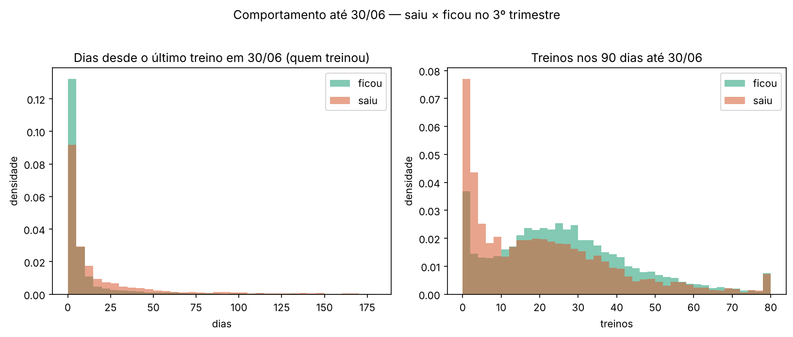

# Comportamento até 30/06 × saída no 3º trimestre (insumo da prática 12)

Gerado por `src/comportamento_usuarios.py` a partir da base tratada (`atividades_limpa.parquet`, sem `flag_impossivel`) e de `uso_mensal.csv` (meses 2026-01..06). Tudo medido até 30/06; saída = `data_fim` entre 01/07 e 30/09.

- Base: **14.059** pagantes ativos em 30/06 · saiu **2.343** (16.7%) · ficou 11.716
- Sem nenhum treino em jan–jun: saiu 3.2% × ficou 2.2%
- Tem treino de relógio: saiu 38.6% × ficou 37.1%

## Medianas por grupo

| Feature | saiu | ficou | diferença |
|---|---:|---:|---:|
| treinos_jan_jun | 30 | 44 | -14 |
| treinos_90d | 17 | 24 | -7 |
| treinos_30d | 5 | 8 | -3 |
| recencia_dias | 6 | 2 | +4 |
| tendencia | 1 | 1.05 | -0.05 |
| n_modalidades | 5 | 5 | +0 |
| pct_relogio | 0 | 0 | +0 |
| sessoes_app_mes | 5.8 | 8.8 | -3 |
| dias_ativos_mes | 3 | 4.8 | -1.8 |
| minutos_mes | 136 | 208 | -72 |

As 3 frases (diz / não diz / próxima pergunta) ficam para a discussão em grupo (papéis Piloto/Auditor/Relator), conforme o roteiro.
