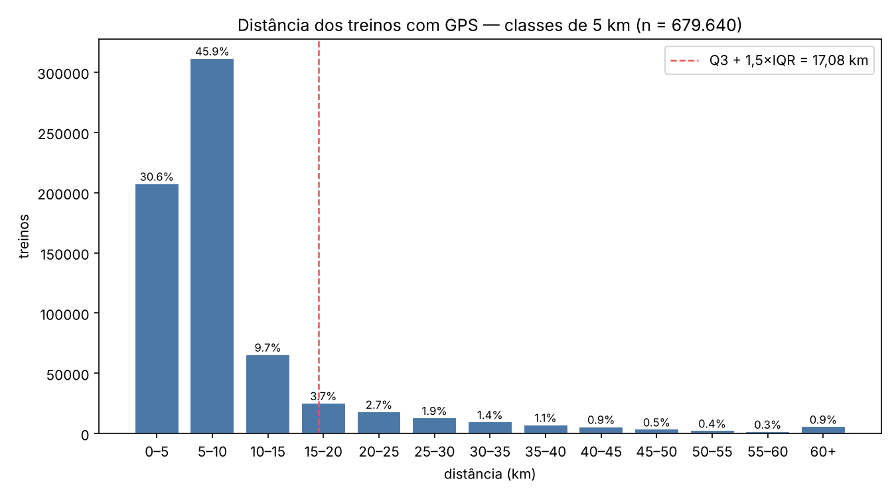

# Distribuição das distâncias (análise 9 · Colaborador 4)

Gerado por `src/distribuicao_distancias.py` a partir de `dados/brutos/atividades.parquet` (só leitura; hash `b5269feac894938c…` conferido antes e depois). Nada foi removido: as duas regras abaixo **marcam** extremos; a decisão é do grupo (`decisoes.md`).

- Treinos com `distancia_km` preenchida: **679.640** de 1.254.475 (os demais não tinham GPS — ausência, não erro).
- Quartis: Q1 **4,58** km · mediana **6,47** · Q3 **9,58** · IQR **5,00**.

## Tabela de frequências (classes de 5 km)

| classe (km) | treinos | % |
|---|---:|---:|
| 0–5 | 207,759 | 30,6% |
| 5–10 | 311,836 | 45,9% |
| 10–15 | 65,775 | 9,7% |
| 15–20 | 25,485 | 3,7% |
| 20–25 | 18,334 | 2,7% |
| 25–30 | 13,214 | 1,9% |
| 30–35 | 9,853 | 1,4% |
| 35–40 | 7,413 | 1,1% |
| 40–45 | 5,861 | 0,9% |
| 45–50 | 3,695 | 0,5% |
| 50–55 | 2,609 | 0,4% |
| 55–60 | 1,838 | 0,3% |
| 60+ | 5,968 | 0,9% |

## Extremos marcados (nada removido)

**Regra 1 — Q3 + 1,5×IQR (> 17,08 km):** 81.775 treinos. Por tipo (nomes em inglês somados ao equivalente em português, mapa da análise 4): pedal 73.120, corrida 8.355, caminhada 300.

**Regra 2 — |z| > 3 (> 191,60 km):** 956 treinos. Por tipo: corrida 555, caminhada 274, pedal 127.

A regra do IQR marca treinos longos porém plausíveis (pedais de 20–60 km); a regra do z marca só o fisicamente impossível (centenas a milhares de km). Proposta para o `decisoes.md`: **marcar** pelos dois critérios e excluir dos agregados de engajamento apenas os impossíveis (>200 km, análise 3), mantendo o registro bruto intacto.

