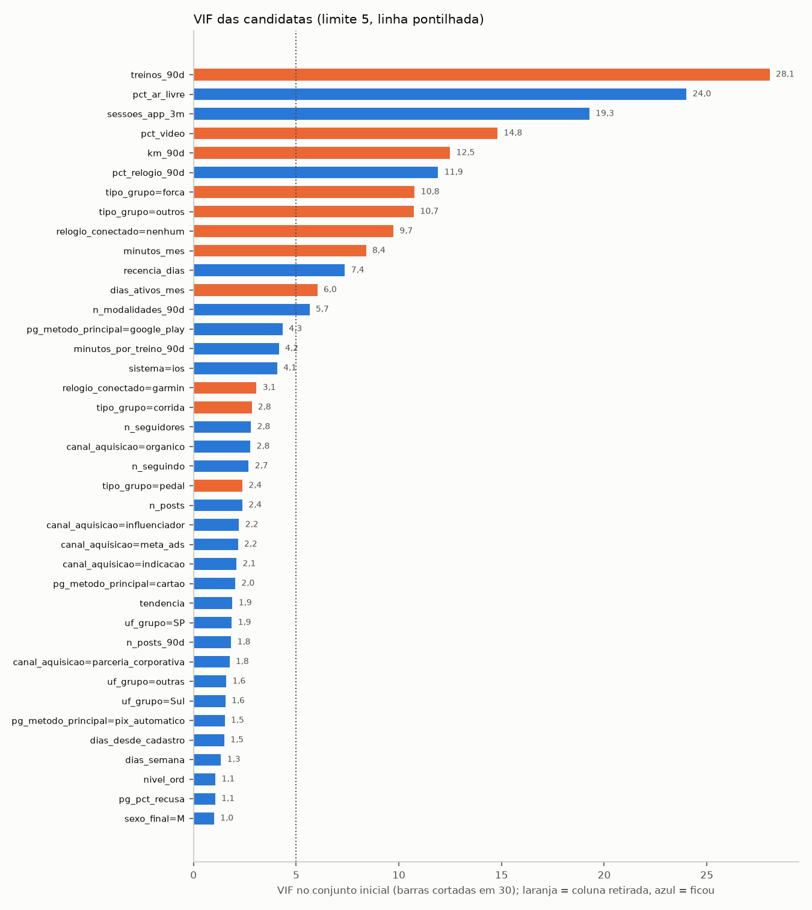
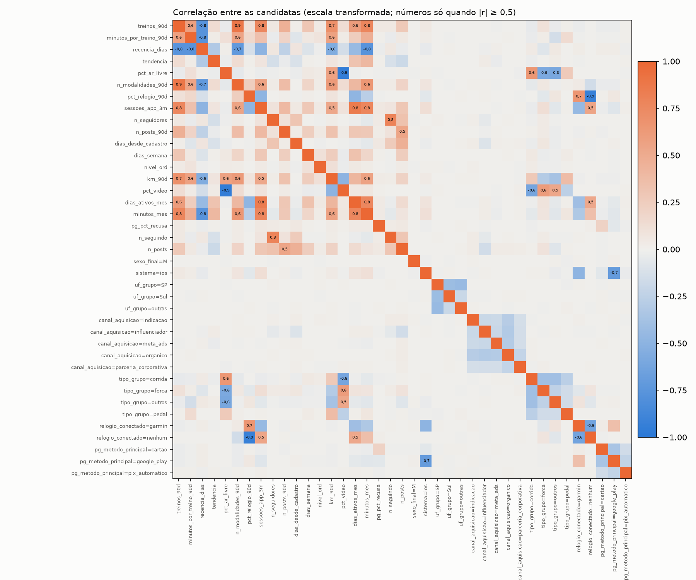
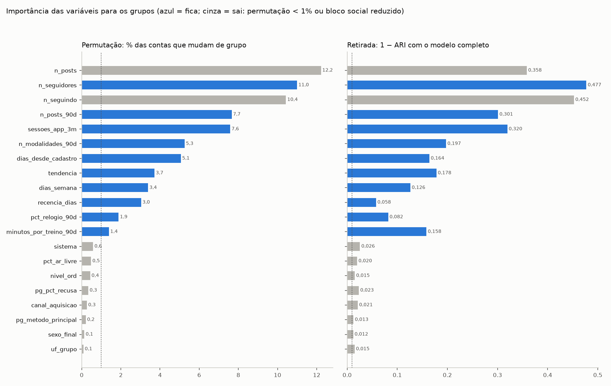
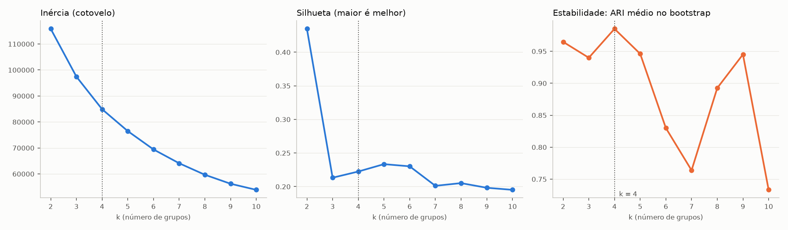
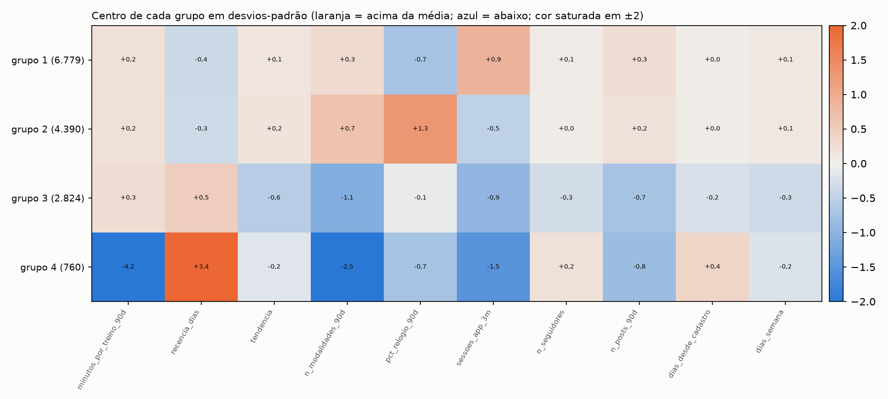

# Segmentação ampliada · perfil + comportamento (ativos em 30/09/2026)

Gerado por `src/segmentacao_ampliada.py --k 3 --k-final 4`. Só leitura (SHA-256 de `usuarios.csv`, `base_master`, base de 30/06 e `atividades_limpa_v2` conferidos antes e depois). A segmentação atual (`segmentos_30set.parquet`, decisões 39 a 41) não foi alterada.

## 1. Contas

| passo | antes | depois | observação |
|---|---|---|---|
| base_master | 64.948 | 64.948 | uma linha por conta |
| usuarios.csv (só e-mail) sem contas de teste | 64.948 | 64.888 | 60 de teste fora |
| ↳ junção com o sexo padronizado da base master (decisão 2) | 64.888 | 64.888 | 1:1 |
| ativos em 30/09 (sem teste) | 64.948 | 14.753 | `ativo_no_corte`; sem filtro de completude |
| ↳ + treinos no corte, sexo imputado e cadastro (junções 1:1) | 14.753 | 14.753 | linhas inalteradas |
| formam os grupos | 14.753 | 14.753 | 3.721 a mais que na segmentação atual (11.032) |

O filtro de completude da decisão 39 deixa de existir: idade sai do agrupamento e os vazios de sexo, nível e dias por semana são preenchidos (seção 2). Todas as 14.753 contas ativas formam os grupos.

## 2. Imputações (cada valor preenchido tem marca `*_imputado` em `dados/processados/perfil_imputado.parquet`)

### 2.1 Sexo pelo nome do e-mail

O `sexo` padronizado (decisão 2) vem da base master. Para os vazios, o primeiro nome é tirado do e-mail (antes de `.` ou `_`; se o nome vem colado, o nome conhecido mais longo no início). A lista nome → sexo é montada com as contas que informaram o sexo.

| medida | valor |
|---|---|
| nomes distintos na lista | 58 |
| nomes ambíguos (entre 10% e 90% de mulheres) | 0 |
| acerto na validação cruzada (5 partes, lista sem a parte testada) | 100,00% |
| cobertura na validação cruzada | 100,00% |
| contas com sexo vazio (todas, sem teste) | 3.140 |
| preenchidas | 3.140 |
| ainda não informado | 0 |
| ativos em 30/09 com sexo vazio → depois | 700 → 0 |

Cuidado: é inferência pelo nome, não o sexo declarado. Serve para não perder a conta no agrupamento; não deve ser usada como dado pessoal da conta.

### 2.2 Nível vazio → iniciante (regra do usuário)

| nível declarado | contas | treinos 90d (mediana) | min por treino (mediana) | km 90d (mediana) | frequência observada/semana (mediana) |
|---|---|---|---|---|---|
| avancado | 2.440 | 27,0 | 48,0 | 57,0 | 1,79 |
| iniciante | 5.336 | 22,0 | 40,9 | 37,1 | 1,48 |
| intermediario | 5.948 | 22,0 | 43,8 | 51,1 | 1,48 |
| nao_informado | 1.029 | 23,0 | 43,3 | 42,4 | 1,56 |

Pelo número de treinos, quem não informou o nível se parece mais com **iniciante**. A regra do usuário foi aplicada mesmo assim (1.029 contas → iniciante, `nivel_imputado`). Nível entra como ordinal (iniciante 1, intermediário 2, avançado 3), uma coluna só.

### 2.3 Dias por semana inferidos dos treinos

Frequência observada = dias distintos com treino nos 90 dias antes do corte ÷ (90/7). Calibração com as 13.006 contas que declararam: Spearman **0,377**, Pearson 0,425. Para não misturar intenção (declarado) com comportamento (observado), o vazio recebe a **mediana do declarado** entre quem tem a mesma faixa de frequência observada (faixas de 0,5/semana; faixa com menos de 30 contas usa a vizinha):

| frequência observada (faixa) | contas que declararam | declarado (mediana) | declarado (média) |
|---|---|---|---|
| 0,0 | 1.943 | 3 | 3,24 |
| 0,5 | 1.377 | 3 | 3,09 |
| 1,0 | 2.052 | 3 | 2,77 |
| 1,5 | 2.211 | 3 | 2,98 |
| 2,0 | 2.056 | 3 | 3,32 |
| 2,5 | 1.751 | 4 | 3,94 |
| 3,0 | 864 | 5 | 4,56 |
| 3,5 | 475 | 5 | 5,42 |
| 4,0 | 169 | 6 | 6,09 |
| 4,5 | 76 | 7 | 6,76 |
| 5,0 | 26 | 7 | 6,96 |
| 5,5 | 6 | 7 | 6,83 |

Cruzamento declarado (linhas) × observado arredondado (colunas, teto 6):

| declarado | 0 | 1 | 2 | 3 | 4 | 5 | 6 |
|---|---|---|---|---|---|---|---|
| 1 | 228 | 439 | 151 | 2 | 0 | 0 | 0 |
| 2 | 620 | 1186 | 731 | 58 | 0 | 0 | 0 |
| 3 | 786 | 1223 | 1543 | 247 | 5 | 0 | 0 |
| 4 | 583 | 607 | 1253 | 578 | 41 | 0 | 0 |
| 5 | 295 | 222 | 493 | 528 | 118 | 1 | 0 |
| 6 | 109 | 68 | 86 | 230 | 101 | 6 | 0 |
| 7 | 63 | 41 | 33 | 88 | 187 | 53 | 3 |

Imputados: 1.747 ativos (`dias_semana_imputado`). A correlação é moderada: a imputação é razoável, mas é estimativa.

## 3. Candidatas e redução das categorias

20 numéricas (10 da segmentação atual + 10 novas) e 7 categóricas. Fora: idade, plano, canal de cobrança, objetivo, sinais de saída e campanha (decisões do usuário e da base master).

| variável | redução | contas |
|---|---|---|
| `sexo_final` | F, M (+ não informado se sobrar) | F: 7.720, M: 7.033 |
| `sistema` | android, ios | android: 7.475, ios: 7.278 |
| `uf_grupo` | 11 UF → SP, RJ_MG, Sul, outras | SP: 7.248, RJ_MG: 2.734, outras: 2.504, Sul: 2.267 |
| `canal_aquisicao` | 6 (nenhuma abaixo de 9%) | organico: 4.634, influenciador: 2.495, meta_ads: 2.425, indicacao: 2.228, google_ads: 1.532, parceria_corporativa: 1.439 |
| `tipo_grupo` | 8 → corrida, forca, caminhada, pedal, outros | corrida: 5.739, forca: 2.902, outros: 2.901, caminhada: 1.756, pedal: 1.455 |
| `relogio_conectado` | nenhum, garmin, apple_watch | nenhum: 9.118, garmin: 2.878, apple_watch: 2.757 |
| `pg_metodo_principal` | app_store, google_play, cartao, pix_automatico | app_store: 5.395, google_play: 4.964, cartao: 2.994, pix_automatico: 1.400 |
| `nivel_ord` | 3 categorias → 1 coluna ordinal | — |

**Peso das dummies:** cada categoria vira uma dummy padronizada (z) multiplicada por 1/√m, em que m é o número de categorias da variável. Assim a soma das variâncias das m dummies é 1, o mesmo peso de uma numérica, e nenhuma variável categórica parte os grupos sozinha. Numéricas: teto no p99, log nas contagens assimétricas e z (como na segmentação atual). Tudo ajustado só nos dados de cada ajuste.

## 4. Estudo de VIF

VIF calculado sobre as numéricas transformadas e as dummies sem a categoria de referência, com constante. Regra: enquanto houver variável com VIF > 5, sai a de maior VIF (o VIF de uma categórica é o maior entre as suas dummies); se houver nova e original acima do limite, sai primeiro a nova, para não perder a base comparável.

| rodada | sai | VIF | coluna mais correlacionada | |r| |
|---|---|---|---|---|
| 1 | `pct_video` | 14,8 | `pct_ar_livre` | 0,95 |
| 2 | `km_90d` | 10,9 | `treinos_90d` | 0,70 |
| 3 | `tipo_grupo` | 10,6 | `pct_ar_livre` | 0,60 |
| 4 | `relogio_conectado` | 9,7 | `pct_relogio_90d` | 0,93 |
| 5 | `minutos_mes` | 7,8 | `sessoes_app_3m` | 0,77 |
| 6 | `dias_ativos_mes` | 5,7 | `sessoes_app_3m` | 0,85 |
| 7 | `treinos_90d` | 19,2 | `n_modalidades_90d` | 0,88 |

| coluna | VIF inicial | VIF final |
|---|---|---|
| treinos_90d | 28,06 | saiu |
| minutos_por_treino_90d | 4,16 | 2,93 |
| recencia_dias | 7,37 | 4,74 |
| tendencia | 1,90 | 1,35 |
| pct_ar_livre | 24,00 | 1,05 |
| n_modalidades_90d | 5,65 | 3,53 |
| pct_relogio_90d | 11,91 | 3,00 |
| sessoes_app_3m | 19,28 | 4,78 |
| n_seguidores | 2,79 | 2,79 |
| n_posts_90d | 1,83 | 1,78 |
| dias_desde_cadastro | 1,49 | 1,47 |
| dias_semana | 1,34 | 1,24 |
| nivel_ord | 1,07 | 1,03 |
| km_90d | 12,50 | saiu |
| pct_video | 14,80 | saiu |
| dias_ativos_mes | 6,03 | saiu |
| minutos_mes | 8,41 | saiu |
| pg_pct_recusa | 1,06 | 1,06 |
| n_seguindo | 2,69 | 2,68 |
| n_posts | 2,38 | 2,31 |
| sexo_final=M | 1,00 | 1,00 |
| sistema=ios | 4,07 | 3,45 |
| uf_grupo=SP | 1,86 | 1,86 |
| uf_grupo=Sul | 1,55 | 1,55 |
| uf_grupo=outras | 1,59 | 1,59 |
| canal_aquisicao=indicacao | 2,09 | 2,09 |
| canal_aquisicao=influenciador | 2,22 | 2,22 |
| canal_aquisicao=meta_ads | 2,16 | 2,16 |
| canal_aquisicao=organico | 2,77 | 2,77 |
| canal_aquisicao=parceria_corporativa | 1,75 | 1,75 |
| tipo_grupo=corrida | 2,83 | saiu |
| tipo_grupo=forca | 10,77 | saiu |
| tipo_grupo=outros | 10,73 | saiu |
| tipo_grupo=pedal | 2,38 | saiu |
| relogio_conectado=garmin | 3,07 | saiu |
| relogio_conectado=nenhum | 9,73 | saiu |
| pg_metodo_principal=cartao | 2,03 | 2,03 |
| pg_metodo_principal=google_play | 4,34 | 4,34 |
| pg_metodo_principal=pix_automatico | 1,52 | 1,52 |

Maior VIF final: **4,78**. 

## 5. Importância das variáveis para os grupos (k = 3)

No K-means não existe p-valor como na regressão: os grupos nascem das próprias variáveis, e qualquer teste entre grupos sai significativo. Por isso a importância é medida de três jeitos:

- **Retirada:** o K-means é refeito sem a variável; `1 − ARI` com o modelo completo mostra quanto os grupos dependem dela.
- **Permutação:** a variável é embaralhada (10 vezes) e as contas são reclassificadas pelo centro mais próximo; mede quantas mudam de grupo.
- **Tamanho do efeito:** η² (numéricas) ou V de Cramér (categóricas) entre grupos. Só descreve: é alto por construção.

Regra do plano: sai se `1 − ARI` < 0,01 e menos de 2% mudam na permutação. Ela não discrimina: refazer o modelo completo com outra semente, sem retirar nada, já dá `1 − ARI` médio de 0,010 (máximo 0,011), e as variáveis fracas ficam logo acima desse ruído. **Regra final (decisão do usuário):** sai a variável que muda menos de 1% das contas na permutação; a retirada (`1 − ARI`) fica como leitura de apoio. O bloco social também foi reduzido, para não pesar quatro vezes: `n_seguindo`: bloco social reduzido (decisão do usuário): fica `n_seguidores`; `n_posts`: bloco social reduzido (decisão do usuário): fica `n_posts_90d`.

| variável | tipo | % mudam (permutação) | 1 − ARI (retirada) | efeito | decisão |
|---|---|---|---|---|---|
| `n_posts` | numérica | 12,2 | 0,358 | 0,412 (η²) | sai |
| `n_seguidores` | numérica | 11,0 | 0,477 | 0,339 (η²) | fica |
| `n_seguindo` | numérica | 10,4 | 0,452 | 0,308 (η²) | sai |
| `n_posts_90d` | numérica | 7,7 | 0,301 | 0,231 (η²) | fica |
| `sessoes_app_3m` | numérica | 7,6 | 0,320 | 0,311 (η²) | fica |
| `n_modalidades_90d` | numérica | 5,3 | 0,197 | 0,457 (η²) | fica |
| `dias_desde_cadastro` | numérica | 5,1 | 0,164 | 0,159 (η²) | fica |
| `tendencia` | numérica | 3,7 | 0,178 | 0,073 (η²) | fica |
| `dias_semana` | numérica | 3,4 | 0,126 | 0,047 (η²) | fica |
| `recencia_dias` | numérica | 3,0 | 0,058 | 0,792 (η²) | fica |
| `pct_relogio_90d` | numérica | 1,9 | 0,082 | 0,035 (η²) | fica |
| `minutos_por_treino_90d` | numérica | 1,4 | 0,158 | 0,653 (η²) | fica |
| `sistema` | categórica (2) | 0,6 | 0,026 | 0,054 (V de Cramér) | sai |
| `pct_ar_livre` | numérica | 0,5 | 0,020 | 0,001 (η²) | sai |
| `nivel_ord` | numérica | 0,4 | 0,015 | 0,001 (η²) | sai |
| `pg_pct_recusa` | numérica | 0,3 | 0,023 | 0,005 (η²) | sai |
| `canal_aquisicao` | categórica (6) | 0,3 | 0,021 | 0,077 (V de Cramér) | sai |
| `pg_metodo_principal` | categórica (4) | 0,2 | 0,013 | 0,039 (V de Cramér) | sai |
| `sexo_final` | categórica (2) | 0,1 | 0,012 | 0,010 (V de Cramér) | sai |
| `uf_grupo` | categórica (4) | 0,1 | 0,015 | 0,017 (V de Cramér) | sai |

Conjunto final: 10 numéricas (`minutos_por_treino_90d`, `recencia_dias`, `tendencia`, `n_modalidades_90d`, `pct_relogio_90d`, `sessoes_app_3m`, `n_seguidores`, `n_posts_90d`, `dias_desde_cadastro`, `dias_semana`) e 0 categóricas (nenhuma).

## 6. Escolha de k no conjunto final

| k | silhueta | Calinski-Harabasz | Davies-Bouldin | ARI bootstrap | ARI mín | menor grupo % |
|---|---|---|---|---|---|---|
| 2 | 0,435 | 4.036 | 1,029 | 0,965 | 0,914 | 7,9 |
| 3 | 0,213 | 3.792 | 1,630 | 0,940 | 0,477 | 7,0 |
| 4 | 0,222 | 3.627 | 1,521 | 0,985 | 0,974 | 5,2 |
| 5 | 0,233 | 3.425 | 1,418 | 0,946 | 0,579 | 5,2 |
| 6 | 0,230 | 3.318 | 1,419 | 0,830 | 0,549 | 5,1 |
| 7 | 0,201 | 3.198 | 1,394 | 0,764 | 0,471 | 5,1 |
| 8 | 0,205 | 3.100 | 1,436 | 0,893 | 0,523 | 5,1 |
| 9 | 0,198 | 2.993 | 1,464 | 0,945 | 0,902 | 5,0 |
| 10 | 0,195 | 2.848 | 1,465 | 0,733 | 0,671 | 4,7 |

## 7. Modelo final (k = 4) e validação cruzada

| teste | ARI médio | pior |
|---|---|---|
| K-fold (5 partes; centros do treino classificam o teste) | 0,996 | 0,992 |
| bootstrap (50 reamostragens) | 0,985 | 0,971 (p5) |
| sementes (20 inícios, n_init = 1) | 0,976 | 0,540 |

| grupo | contas | Jaccard K-fold | Jaccard bootstrap |
|---|---|---|---|
| 1 | 6.779 | 1,000 | 1,000 |
| 2 | 4.390 | 0,999 | 0,992 |
| 3 | 2.824 | 0,993 | 0,969 |
| 4 | 760 | 0,998 | 0,992 |

Medianas das numéricas por grupo (escala original):

| grupo | minutos_por_treino_90d | recencia_dias | tendencia | n_modalidades_90d | pct_relogio_90d | sessoes_app_3m | n_seguidores | n_posts_90d | dias_desde_cadastro | dias_semana |
|---|---|---|---|---|---|---|---|---|---|---|
| 1 | 43,3 | 1,0 | 1,1 | 4,0 | 0,0 | 13,0 | 2,0 | 2,0 | 272,0 | 3,0 |
| 2 | 43,2 | 2,0 | 1,1 | 5,0 | 78,7 | 3,7 | 1,0 | 2,0 | 268,0 | 3,0 |
| 3 | 44,7 | 13,0 | 1,0 | 2,0 | 0,0 | 2,0 | 1,0 | 0,0 | 235,5 | 3,0 |
| 4 | 0,0 | 90,0 | 1,0 | 0,0 | 0,0 | 1,0 | 2,0 | 0,0 | 483,0 | 3,0 |

Descritivas (não formaram os grupos):

| grupo | contas | % mensal | % renovação desligada | idade (mediana) | % feminino | % iOS | tipo mais comum | região mais comum | canal mais comum | relógio mais comum | nível médio (1–3) | dias/semana (mediana) |
|---|---|---|---|---|---|---|---|---|---|---|---|---|
| 1 | 6.779 | 49,7 | 4,6 | 47,1 | 51,9 | 50,8 | corrida | SP | organico | nenhum | 1,74 | 3,0 |
| 2 | 4.390 | 50,0 | 6,5 | 47,0 | 52,8 | 49,6 | corrida | SP | organico | garmin | 1,73 | 3,0 |
| 3 | 2.824 | 24,9 | 49,2 | 46,6 | 52,7 | 46,8 | corrida | SP | organico | nenhum | 1,73 | 3,0 |
| 4 | 760 | 0,4 | 34,9 | 46,9 | 52,0 | 44,2 | corrida | SP | organico | nenhum | 1,69 | 3,0 |

## 8. Comparação com a segmentação atual (decisões 39 a 41)

ARI entre os grupos novos e os atuais: **0,931** nas 11.032 contas que formaram os grupos atuais e 0,930 nas 14.753 contas. Cruzamento (linhas = persona atual; colunas = grupo novo):

| persona | 1 | 2 | 3 | 4 |
|---|---|---|---|---|
| Engajado com relógio | 0 | 4293 | 69 | 0 |
| Engajado no app | 6713 | 0 | 180 | 0 |
| Esfriando | 66 | 97 | 2575 | 1 |
| Parado (anual dormente) | 0 | 0 | 0 | 759 |

## 9. Saída em 60 dias por grupo (corte de 30/06, só descreve)

Os 14.059 ativos de 30/06 foram montados com as mesmas variáveis no corte de 30/06 (treinos até 30/06, cadastro até 30/06, mesma lista de nomes e mesma tabela de frequência) e classificados pelo centro mais próximo.

| grupo | contas em 30/06 | % em 30/06 | % em 30/09 | saiu em 60 dias |
|---|---|---|---|---|
| 1 | 6.597 | 46,9 | 45,9 | 9,9% |
| 2 | 4.219 | 30,0 | 29,8 | 10,6% |
| 3 | 2.490 | 17,7 | 19,1 | 18,4% |
| 4 | 753 | 5,4 | 5,2 | 16,1% |

Amplitude da saída entre grupos: 8,5 p.p. (na segmentação atual: 9,8% a 19,4%, amplitude 9,6 p.p.).

## 10. Leitura

- **Perfil não separa assinantes:** sexo, região, canal de aquisição, sistema, método de pagamento e nível mudam menos de 1% das contas de grupo, mesmo com peso igual ao de uma numérica. A % de mulheres e a idade mediana são praticamente iguais em todos os grupos.
- **Os grupos são os mesmos da segmentação atual** (ARI 0,931), agora sem o filtro de completude: 14.753 contas formam os grupos, contra 11.032. As personas foram mantidas: 1 Engajado no app (6.779), 2 Engajado com relógio (4.390), 3 Esfriando (2.824), 4 Parado (anual dormente) (760).
- **Ganhos:** VIF máximo abaixo de 5 (na atual, `treinos_90d` tinha 18,7), todas as contas ativas no ajuste e duas variáveis novas com efeito (`dias_desde_cadastro` e `dias_semana`).

## 11. Decisões 45 a 47 (gravadas no `decisoes.md` em 10/11/2026)

| # | Data | Arquivo | Problema | Decisão (corrigir/remover/marcar) | Motivo | Efeito na contagem (antes → depois) |
|---|------|---------|----------|-----------------------------------|--------|-------------------------------------|
| 45 | 10/11/2026 | base_master + usuarios.csv + atividades_limpa_v2 | vazios de sexo, nível e dias por semana tiravam contas da segmentação | corrigir na cópia `perfil_imputado.parquet` com marca `*_imputado`: sexo pelo nome do e-mail (acerto 100,0% na validação cruzada); nível vazio = iniciante; dias por semana = mediana do declarado na mesma faixa de frequência observada; idade fora | pedido do usuário; mantém todas as contas no agrupamento | ativos sem sexo 700 → 0; nível 1.029 → 0; dias por semana 1.747 → 0 |
| 46 | 10/11/2026 | base_master | variáveis do K-means ampliado | candidatas com dummies de peso 1/√m; VIF iterativo (> 5 sai: pct_video, km_90d, tipo_grupo, relogio_conectado, minutos_mes, dias_ativos_mes, treinos_90d); sai quem muda < 1% das contas na permutação; bloco social reduzido (sem `n_seguindo` e `n_posts`) | evitar peso duplo e variáveis sem efeito nos grupos | 27 candidatas → 10 variáveis |
| 47 | 10/11/2026 | base_master | segmentação dos ativos em 30/09 | k = 4 (ARI K-fold 0,996, bootstrap 0,985); `segmentos_ampliada_30set.parquet` passa a ser a segmentação de referência, com as personas atuais | mesmos grupos da atual (ARI 0,931) sem perder contas | 11.032 → 14.753 contas nos grupos (6.779, 4.390, 2.824, 760) |

---
Conferências: `pct_ar_livre` recalculado = base master (maior diferença 0,000); `usuarios.csv` inalterado; `base_master.parquet` inalterado; `base_assinantes_2026-06-30.parquet` inalterado; `atividades_limpa_v2.parquet` inalterado.