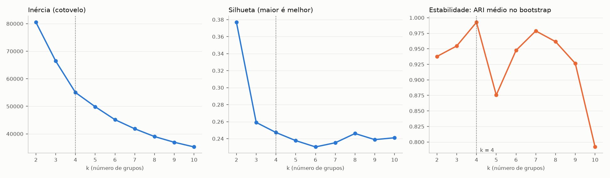
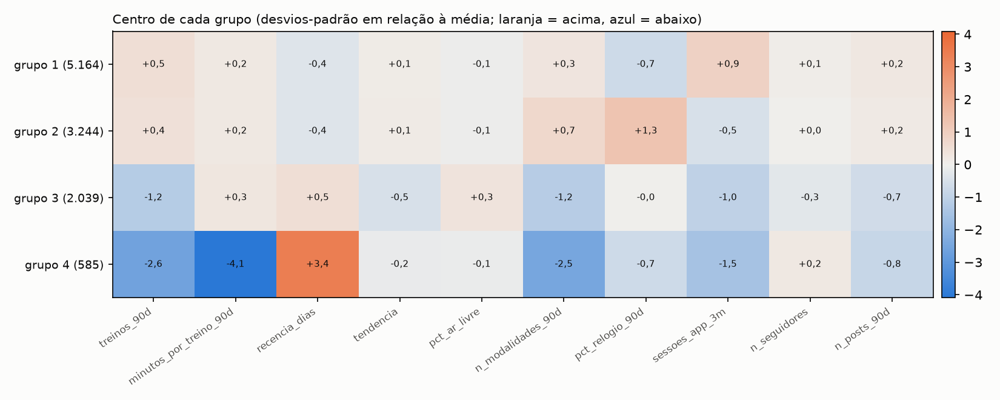

# Segmentação K-means · assinantes ativos em 30/09/2026 (k = 4)

Gerado por `src/segmentacao_kmeans.py --k 4`. Entrada: `base_master.parquet` (SHA-256 `a22dfea4bdc05e06…`, não alterada). Grupos formados **sem a variável de saída**; saída aparece só depois, na seção 7.

## 1. População (linhas antes e depois)

| passo | linhas antes | linhas depois | observação |
|---|---|---|---|
| base_master | 64.948 | 64.948 | uma linha por conta |
| ativos no corte (sem teste) | 64.948 | 14.753 | `ativo_no_corte` |
| ↳ com idade ausente ou inválida | 14.753 | 897 | marca |
| ↳ com sexo não informado | 14.753 | 700 | marca |
| ↳ com nível não informado | 14.753 | 1.029 | marca |
| ↳ com dias por semana não informado | 14.753 | 1.491 | marca |
| contas completas (formam os grupos) | 14.753 | 11.032 | 3.721 incompletas ficam fora do ajuste |

## 2. Viés da completude: completas × incompletas

Diferença padronizada de médias (SMD = diferença ÷ desvio-padrão combinado). |SMD| < 0,1 é desprezível; 0,1 a 0,2 pequeno; acima de 0,2 merece atenção.

| variável | completas (11.032) | incompletas (3.721) | SMD |
|---|---|---|---|
| treinos_90d | 24,94 | 25,16 | -0,01 |
| minutos_por_treino_90d | 44,99 | 45,51 | -0,02 |
| recencia_dias | 11,47 | 11,22 | 0,01 |
| tendencia | 1,48 | 1,51 | -0,01 |
| pct_ar_livre | 53,81 | 53,90 | -0,00 |
| n_modalidades_90d | 3,71 | 3,73 | -0,01 |
| pct_relogio_90d | 27,81 | 28,72 | -0,02 |
| sessoes_app_3m | 8,27 | 8,23 | 0,00 |
| n_seguidores | 1,66 | 1,66 | -0,00 |
| n_posts_90d | 1,52 | 1,47 | 0,03 |
| mensal | 0,42 | 0,43 | -0,01 |
| renov_desl | 0,15 | 0,15 | -0,01 |
| pg_pct_recusa | 0,81 | 0,77 | 0,01 |
| n_tickets_90d | 0,04 | 0,04 | 0,03 |

Maior |SMD|: **0,03**. As incompletas se parecem com as completas: o filtro não distorce os grupos.

## 3. Variáveis do agrupamento

Só comportamento (decisão do usuário): perfil (idade, dias por semana declarados, tempo de cadastro) e pagamentos ficam para descrever.

| variável | transformação | teto p99 + z |
|---|---|---|
| treinos_90d | log1p | sim |
| minutos_por_treino_90d | log1p | sim |
| recencia_dias | — | sim |
| tendencia | log1p | sim |
| pct_ar_livre | — | sim |
| n_modalidades_90d | — | sim |
| pct_relogio_90d | — | sim |
| sessoes_app_3m | log1p | sim |
| n_seguidores | log1p | sim |
| n_posts_90d | log1p | sim |

Retiradas antes de agrupar: `minutos_90d`: correlação de Spearman 0,97 com `treinos_90d` (substituída por `minutos_por_treino_90d`); `n_tickets_90d`: quase constante (média 0,04, máximo 2): formaria um grupo só de quem abriu ticket; vai para o perfil.

## 4. Escolha de k

| k | inércia | silhueta | Calinski-Harabasz | Davies-Bouldin | ARI bootstrap (10) | ARI mínimo | menor grupo |
|---|---|---|---|---|---|---|---|
| 2 | 80.491 | 0,377 | 4.088 | 1,291 | 0,938 | 0,811 | 15,5% |
| 3 | 66.432 | 0,259 | 3.643 | 1,443 | 0,955 | 0,898 | 5,3% |
| 4 | 55.015 | 0,247 | 3.695 | 1,390 | 0,993 | 0,989 | 5,3% |
| 5 | 49.847 | 0,238 | 3.344 | 1,452 | 0,876 | 0,602 | 5,3% |
| 6 | 45.151 | 0,230 | 3.183 | 1,349 | 0,947 | 0,857 | 5,3% |
| 7 | 41.835 | 0,235 | 3.008 | 1,424 | 0,979 | 0,895 | 5,3% |
| 8 | 39.019 | 0,246 | 2.878 | 1,496 | 0,962 | 0,723 | 5,3% |
| 9 | 36.944 | 0,239 | 2.737 | 1,453 | 0,926 | 0,791 | 5,2% |
| 10 | 35.254 | 0,241 | 2.608 | 1,460 | 0,792 | 0,708 | 5,0% |

## 5. Validação cruzada da estabilidade

| teste | ARI médio | pior |
|---|---|---|
| K-fold (5 dobras): ajusta em 4/5, classifica a dobra de fora | 0,997 | 0,994 |
| Bootstrap (50 reamostras): ajusta na reamostra, classifica todos | 0,993 | 0,989 (p5) |
| Sementes (20 inicializações, n_init = 1) | 0,897 | 0,318 |

Critério combinado: ARI ≥ 0,8 estável; 0,6 a 0,8 moderado; abaixo de 0,6 instável.

| grupo | Jaccard K-fold | Jaccard bootstrap |
|---|---|---|
| 1 | 0,999 | 0,997 |
| 2 | 0,998 | 0,996 |
| 3 | 0,994 | 0,985 |
| 4 | 1,000 | 1,000 |

Jaccard por grupo: quanto cada grupo se reencontra (≥ 0,75 estável; 0,5 a 0,75 moderado; < 0,5 se desfaz).

## 6. Perfil dos grupos (contas completas)

Medianas na escala original:

| grupo | contas | treinos_90d | min_por_treino | recencia | tendencia | pct_ar_livre | modalidades | pct_relogio | sessoes_3m | seguidores | posts_90d |
|---|---|---|---|---|---|---|---|---|---|---|---|
| 1 | 5.164 | 29,0 | 43,2 | 2,0 | 1,1 | 73,3 | 4,0 | 0,0 | 12,7 | 1,0 | 2,0 |
| 2 | 3.244 | 28,0 | 43,2 | 1,0 | 1,1 | 72,7 | 5,0 | 78,3 | 3,7 | 1,0 | 2,0 |
| 3 | 2.039 | 4,0 | 45,1 | 13,0 | 1,0 | 77,8 | 2,0 | 0,0 | 2,0 | 1,0 | 0,0 |
| 4 | 585 | 0,0 | 0,0 | 90,0 | 1,0 | 70,8 | 0,0 | 0,0 | 1,0 | 2,0 | 0,0 |

Descritivas (não formaram os grupos):

| grupo | % mensal | % renovação desligada | idade (mediana) | % feminino | % com ticket 90d | recusa média (%) | tipo principal | canal mais comum | nível mais comum |
|---|---|---|---|---|---|---|---|---|---|
| 1 | 50,0 | 4,1 | 47,0 | 51,7 | 4,5 | 1,0 | corrida | app_store | intermediario |
| 2 | 50,6 | 5,2 | 47,0 | 53,3 | 3,9 | 0,8 | corrida | app_store | intermediario |
| 3 | 22,2 | 53,8 | 46,7 | 53,6 | 4,1 | 0,4 | corrida | google_play | intermediario |
| 4 | 0,5 | 34,5 | 47,2 | 52,3 | 2,1 | 0,6 | corrida | google_play | intermediario |

Campanha de 10/08 por grupo (sorteio aleatório: as proporções devem ser parecidas entre grupos):

| grupo | conteudo | controle | cupom | desafio | fora_da_campanha |
|---|---|---|---|---|---|
| 1 | 22.5 | 23.2 | 22.7 | 22.3 | 9.3 |
| 2 | 23.2 | 21.4 | 21.1 | 23.2 | 11.1 |
| 3 | 18.3 | 18.8 | 17.4 | 17.5 | 28.0 |
| 4 | 23.9 | 28.2 | 27.4 | 19.8 | 0.7 |

Incompletas classificadas pelo centro mais próximo (não formaram grupos): grupo 1: 1.729, grupo 2: 1.118, grupo 3: 700, grupo 4: 174.

## 7. Depois de agrupar: estabilidade no tempo e saída em 60 dias (corte de 30/06, só descreve)

| grupo | % em 30/09 (completas) | contas em 30/06 | % em 30/06 | saiu em 60 dias (30/06) |
|---|---|---|---|---|
| 1 | 46,8 | 6.721 | 47,8 | 9,8% |
| 2 | 29,4 | 4.265 | 30,3 | 10,4% |
| 3 | 18,5 | 2.320 | 16,5 | 19,4% |
| 4 | 5,3 | 753 | 5,4 | 16,1% |

Saída média em 60 dias no corte de 30/06: 11,9%. A taxa por grupo não foi usada para formar os grupos: só mostra se eles separam risco.

## 8. Personas (leitura do perfil)

| grupo | persona | contas (completas) | o que define | saiu em 60 dias (30/06) |
|---|---|---|---|---|
| 1 | Engajado no app | 5.164 | treina com frequência (mediana de 29 treinos em 90 dias) e registra pelo app, sem relógio; é quem mais abre o app (12,7 sessões por mês) | 9,8% |
| 2 | Engajado com relógio | 3.244 | treina tanto quanto o grupo 1, mas 78% dos treinos vêm do relógio; abre pouco o app (3,7 sessões) e varia mais de modalidade | 10,4% |
| 3 | Esfriando | 2.039 | poucos treinos (4 em 90 dias), último há 13 dias, pouco app e quase nada no social; 54% já desligaram a renovação; mais recentes (28% chegaram depois do sorteio de 10/08) | 19,4% |
| 4 | Parado (anual dormente) | 585 | nenhum treino em 90 dias e quase nenhum uso do app; 99,5% no plano anual (paga e não usa); 35% com renovação desligada | 16,1% |

Leitura para o negócio (hipóteses, não causa): os grupos 1 e 2 são a base saudável, separados pelo jeito de registrar o treino; o 3 concentra o risco (perto do dobro da saída média) e ainda treina um pouco, então é onde agir tem mais chance; o 4 é o anual que já parou e só sai no aniversário, o que dá prazo para agir antes do vencimento.

## 9. Notas

- **Sementes com uma única inicialização:** média 0,897, mas o pior caso cai a 0,318: com `n_init = 1` o K-means às vezes para num mínimo local ruim. O modelo final usa `n_init = 20`, e por isso o K-fold e o bootstrap ficam acima de 0,99.
- **Campanha por grupo:** entre os sorteados, os quatro braços têm proporções parecidas em cada grupo; a diferença está em `fora_da_campanha`, maior no grupo 3 porque ele tem mais assinantes que chegaram depois de 10/08.
- **Grupo 4 e o teto da recência:** 90 dias é o teto de quem não treinou na janela; o grupo 4 é, na prática, quem não treinou em 90 dias.
- **Incompletas:** as 3.721 contas sem perfil completo têm o mesmo comportamento das completas (maior |SMD| 0,03) e foram classificadas pelo centro mais próximo, em proporções parecidas.

## 10. Decisões 39 a 41 (gravadas no `decisoes.md` em 10/11/2026)

| # | Data | Arquivo | Problema | Decisão (corrigir/remover/marcar) | Motivo | Efeito na contagem (antes → depois) |
|---|------|---------|----------|-----------------------------------|--------|-------------------------------------|
| 39 | 10/11/2026 | base_master | contas sem perfil ou onboarding completo na segmentação | formar os grupos só com as contas completas (sem idade inválida e sem sexo, nível ou dias por semana não informados); classificar as incompletas depois pelo centro mais próximo | pedido do usuário; o viés medido é desprezível (maior SMD 0,03) | 14.753 → 11.032 formam os grupos; 3.721 classificadas depois |
| 40 | 10/11/2026 | base_master | variáveis do K-means | só comportamento (treinos_90d, minutos_por_treino_90d, recencia_dias, tendencia, pct_ar_livre, n_modalidades_90d, pct_relogio_90d, sessoes_app_3m, n_seguidores, n_posts_90d); teto no p99, log nas contagens e padronização z ajustados no treino; `minutos_90d` (r 0,97) e `n_tickets_90d` (quase constante) fora | perfil e pagamentos repetem plano e cadastro (descritivos); evitar peso duplo e grupos de exceção | 10 variáveis; base master inalterada |
| 41 | 10/11/2026 | base_master | número de grupos | k = 4, pela estabilidade (ARI K-fold 0,997, bootstrap 0,993) e por Calinski-Harabasz e Davies-Bouldin melhores que k = 3; personas: Engajado no app, Engajado com relógio, Esfriando, Parado (anual dormente) | k = 2 tem a maior silhueta, mas só separa ativo de inativo | 11.032 contas em 4 grupos (5.164, 3.244, 2.039, 585) |