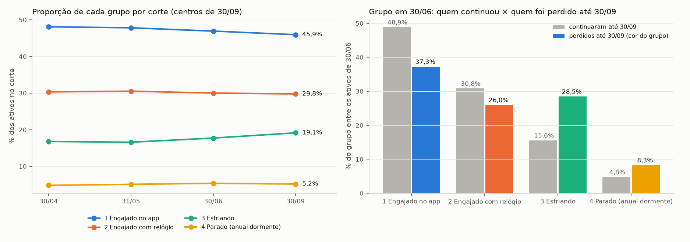

# Viés de sobrevivência na segmentação (ativos em 30/09/2026)

Gerado por `src/segmentacao_vies_sobrevivencia.py`. Só leitura (SHA-256 das entradas conferido antes e depois). A segmentação de referência (`segmentos_ampliada_30set.parquet`, decisões 45 a 47) não muda.

**Pergunta:** a segmentação usa só quem estava ativo em 30/09. Quem saiu antes não está nela. Isso distorce os grupos?

## 0. Contas e reprodução do modelo

| passo | antes | depois | observação |
|---|---|---|---|
| ativos em 30/09 (base master) | 64.948 | 14.753 | `ativo_no_corte` |
| ativos em 30/04 (base_assinantes) | 14.119 | 14.119 | montada no próprio corte; junções 1:1 |
| ativos em 31/05 (base_assinantes) | 14.102 | 14.102 | montada no próprio corte; junções 1:1 |
| ativos em 30/06 (base_assinantes) | 14.059 | 14.059 | montada no próprio corte; junções 1:1 |
| ativos em 30/04 e em 31/05 | 14.119 / 14.102 | 13.093 | junção interna por `user_id` |
| ativos em 31/05 e em 30/06 | 14.102 / 14.059 | 13.236 | junção interna por `user_id` |
| ativos em 30/06 e em 30/09 | 14.059 / 14.753 | 11.716 | junção interna por `user_id` |
| ativos em 30/06 que não estão ativos em 30/09 (perdidos) | 14.059 | 2.343 | `user_id` fora dos ativos de 30/09 |
| cortes empilhados | 14.119 + 14.102 + 14.059 + 14.753 | 57.033 | 18.988 assinantes distintos |

Modelo de referência refeito (10 variáveis da decisão 46, k = 4, mesma semente): grupo idêntico em 14.753 de 14.753 contas (ARI 1,000). Os outros cortes foram montados no próprio corte (treinos, cadastro e 90 dias até a data) e classificados pelos centros de 30/09.

## 1. Os grupos em cada corte

% dos ativos (intervalo de 95%):

| grupo | 30/04 (14.119) | 31/05 (14.102) | 30/06 (14.059) | 30/09 (14.753) |
|---|---|---|---|---|
| 1 Engajado no app | 48,1 (47,3–48,9) | 47,8 (47,0–48,7) | 46,9 (46,1–47,7) | 45,9 (45,1–46,8) |
| 2 Engajado com relógio | 30,3 (29,6–31,1) | 30,5 (29,8–31,3) | 30,0 (29,3–30,8) | 29,8 (29,0–30,5) |
| 3 Esfriando | 16,8 (16,2–17,4) | 16,6 (16,0–17,2) | 17,7 (17,1–18,3) | 19,1 (18,5–19,8) |
| 4 Parado (anual dormente) | 4,8 (4,4–5,2) | 5,1 (4,7–5,4) | 5,4 (5,0–5,7) | 5,2 (4,8–5,5) |

Maior diferença contra 30/09: **2,6 p.p.** (critério do plano: até 2 p.p. = a foto de setembro é típica).

% de anuais em cada grupo e corte:

| grupo | 30/04 | 31/05 | 30/06 | 30/09 |
|---|---|---|---|---|
| 1 Engajado no app | 50,7 | 51,8 | 51,7 | 50,3 |
| 2 Engajado com relógio | 50,4 | 51,4 | 51,7 | 50,0 |
| 3 Esfriando | 71,5 | 72,7 | 75,1 | 75,1 |
| 4 Parado (anual dormente) | 99,3 | 99,2 | 99,5 | 99,6 |

Transições entre cortes (quem estava ativo nos dois; linhas = grupo no corte anterior, % que vai para cada grupo):

**30/04 → 31/05** (13.093 assinantes; 87,0% ficam no mesmo grupo):

| de \ para | 1 | 2 | 3 | 4 |
|---|---|---|---|---|
| 1 Engajado no app | 94.9 | 0.0 | 5.1 | 0.0 |
| 2 Engajado com relógio | 0.0 | 94.2 | 5.8 | 0.0 |
| 3 Esfriando | 24.0 | 15.6 | 51.2 | 9.1 |
| 4 Parado (anual dormente) | 0.3 | 1.1 | 17.2 | 81.4 |

**31/05 → 30/06** (13.236 assinantes; 87,6% ficam no mesmo grupo):

| de \ para | 1 | 2 | 3 | 4 |
|---|---|---|---|---|
| 1 Engajado no app | 94.2 | 0.0 | 5.8 | 0.0 |
| 2 Engajado com relógio | 0.0 | 93.2 | 6.8 | 0.0 |
| 3 Esfriando | 20.5 | 12.9 | 58.0 | 8.7 |
| 4 Parado (anual dormente) | 0.0 | 0.1 | 16.3 | 83.5 |

**30/06 → 30/09** (11.716 assinantes; 79,0% ficam no mesmo grupo):

| de \ para | 1 | 2 | 3 | 4 |
|---|---|---|---|---|
| 1 Engajado no app | 87.7 | 0.0 | 10.9 | 1.4 |
| 2 Engajado com relógio | 0.0 | 88.4 | 10.1 | 1.5 |
| 3 Esfriando | 28.0 | 16.0 | 39.8 | 16.2 |
| 4 Parado (anual dormente) | 3.8 | 3.2 | 35.2 | 57.8 |

## 2. Em que grupo estava quem saiu

### 2.1 Rótulo de 60 dias em cada corte

| corte | grupo | contas | saiu em 60 dias | % entre os que saíram | % entre os que ficaram |
|---|---|---|---|---|---|
| 30/04 | 1 Engajado no app | 6.791 | 11,5% | 43,8 | 48,7 |
| 30/04 | 2 Engajado com relógio | 4.281 | 11,2% | 27,0 | 30,8 |
| 30/04 | 3 Esfriando | 2.369 | 18,5% | 24,6 | 15,7 |
| 30/04 | 4 Parado (anual dormente) | 678 | 12,2% | 4,7 | 4,8 |
| 31/05 | 1 Engajado no app | 6.745 | 10,5% | 41,4 | 48,7 |
| 31/05 | 2 Engajado com relógio | 4.303 | 10,9% | 27,5 | 30,9 |
| 31/05 | 3 Esfriando | 2.338 | 19,0% | 26,1 | 15,3 |
| 31/05 | 4 Parado (anual dormente) | 716 | 12,0% | 5,0 | 5,1 |
| 30/06 | 1 Engajado no app | 6.597 | 9,9% | 38,9 | 48,0 |
| 30/06 | 2 Engajado com relógio | 4.219 | 10,6% | 26,6 | 30,5 |
| 30/06 | 3 Esfriando | 2.490 | 18,4% | 27,3 | 16,4 |
| 30/06 | 4 Parado (anual dormente) | 753 | 16,1% | 7,2 | 5,1 |

A janela de 60 dias de 30/06 passa pela campanha de 10/08; as de 30/04 e 31/05, não.

### 2.2 Perdidos entre 30/06 e 30/09

2.343 dos 14.059 ativos de 30/06 não estão ativos em 30/09 (16,7%).

| grupo em 30/06 | % entre os perdidos | % entre os que continuaram | % do grupo que foi perdido |
|---|---|---|---|
| 1 Engajado no app | 37,3 | 48,9 | 13,2 |
| 2 Engajado com relógio | 26,0 | 30,8 | 14,4 |
| 3 Esfriando | 28,5 | 15,6 | 26,8 |
| 4 Parado (anual dormente) | 8,3 | 4,8 | 25,8 |

**Reponderação:** proporções de 30/09 se os perdidos voltassem para o grupo que tinham em 30/06.

| grupo | 30/09 (observado) | 30/09 reponderado | diferença (p.p.) |
|---|---|---|---|
| 1 Engajado no app | 45,9 | 44,8 | -1,2 |
| 2 Engajado com relógio | 29,8 | 29,2 | -0,5 |
| 3 Esfriando | 19,1 | 20,4 | +1,3 |
| 4 Parado (anual dormente) | 5,2 | 5,6 | +0,4 |

## 3. K-means com os quatro cortes empilhados

57.033 linhas (uma por assinante e corte; 18.988 assinantes), mesmas 10 variáveis, mesmo pré-processamento, k = 4.

| medida | valor |
|---|---|
| ARI empilhado × referência, linhas de 30/09 | 0,871 |
| ARI empilhado × referência, todas as linhas | 0,875 |
| bootstrap por assinante (20 reamostragens): ARI médio | 0,902 |
| bootstrap por assinante: pior ARI | 0,554 |

Critério do plano: ARI ≥ 0,9 = os grupos não dependem de terem sobrevivido até setembro. Cruzamento (linhas = persona de referência; colunas = grupo do empilhado):

| grupo | 0 | 1 | 2 | 3 |
|---|---|---|---|---|
| Engajado com relógio | 17016 | 169 | 8 | 0 |
| Engajado no app | 2 | 268 | 26642 | 0 |
| Esfriando | 1347 | 7352 | 1321 | 1 |
| Parado (anual dormente) | 0 | 0 | 0 | 2907 |

Outros k no empilhado (há algum grupo que a foto de 30/09 perde?):

| k | silhueta | Calinski-Harabasz | Davies-Bouldin | ARI com a referência |
|---|---|---|---|---|
| 2 | 0,478 | 21.035 | 0,944 | 0,146 |
| 3 | 0,205 | 17.608 | 1,684 | 0,720 |
| 4 | 0,225 | 15.701 | 1,532 | 0,875 |
| 5 | 0,219 | 14.977 | 1,461 | 0,672 |
| 6 | 0,234 | 14.620 | 1,405 | 0,571 |

| k | contas | % mensal | recência (mediana) | persona de referência mais comum |
|---|---|---|---|---|
| 2 | 52.208 | 46,4 | 2 | Engajado no app (51,5%) |
| 2 | 4.825 | 0,6 | 90 | Parado (anual dormente) (60,2%) |
| 3 | 28.621 | 48,5 | 2 | Engajado no app (93,4%) |
| 3 | 24.128 | 42,9 | 3 | Engajado com relógio (68,4%) |
| 3 | 4.284 | 0,6 | 90 | Parado (anual dormente) (67,9%) |
| 4 | 27.971 | 49,2 | 2 | Engajado no app (95,2%) |
| 4 | 18.365 | 49,1 | 2 | Engajado com relógio (92,7%) |
| 4 | 7.789 | 18,8 | 26 | Esfriando (94,4%) |
| 4 | 2.908 | 0,6 | 90 | Parado (anual dormente) (100,0%) |
| 5 | 22.348 | 48,0 | 2 | Engajado no app (99,1%) |
| 5 | 15.667 | 47,4 | 2 | Engajado com relógio (95,3%) |
| 5 | 12.037 | 48,7 | 2 | Esfriando (44,2%) |
| 5 | 4.075 | 5,5 | 46 | Esfriando (92,4%) |
| 5 | 2.906 | 0,6 | 90 | Parado (anual dormente) (100,0%) |
| 6 | 19.835 | 49,4 | 2 | Engajado no app (99,1%) |
| 6 | 14.871 | 48,5 | 2 | Engajado com relógio (93,9%) |
| 6 | 11.136 | 48,6 | 3 | Esfriando (46,0%) |
| 6 | 4.364 | 37,1 | 2 | Engajado no app (58,2%) |
| 6 | 3.921 | 5,3 | 47 | Esfriando (93,0%) |
| 6 | 2.906 | 0,6 | 90 | Parado (anual dormente) (100,0%) |

## 4. Leitura

- **O viés existe, mas é pequeno e concentrado no grupo Esfriando.** Entre os perdidos de 30/06 a 30/09, 28,5% eram Esfriando (contra 15,6% entre os que continuaram) e 8,3% Parado (contra 4,8%). Devolvendo os perdidos, o Esfriando de 30/09 passaria de 19,1% para 20,4%: a foto de setembro subestima um pouco quem esfria, porque parte já saiu.
- **As proporções quase não mudam entre cortes**, mas o Esfriando cresce de 16,8% (30/04) para 19,1% (30/09), e a diferença máxima (2,6 p.p.) passa um pouco do critério de 2 p.p. Dentro do Esfriando a parcela de anuais sobe de 71,5% para 75,1%: o mensal que esfria sai, o anual que esfria fica. É o efeito do plano descrito na pergunta.
- **O Parado é anual em todos os cortes** (99,2% a 99,6%). Nenhum k do empilhado (2 a 6) mostra um "mensal parado": o mensal que para de treinar sai antes de chegar a 90 dias sem treino. O grupo depende da regra do plano, não só do comportamento.
- **No empilhado, os grupos centrais se repetem** (ARI 0,875, um pouco abaixo do critério de 0,9). A diferença está quase toda no Esfriando: 7.352 de 10.021 linhas de Esfriando (73,4%) caem no mesmo grupo; o resto vai para os engajados. Engajado no app, Engajado com relógio e Parado coincidem em mais de 98%. A fronteira do Esfriando é a menos firme.
- **Quem sai, sai mais do Esfriando em todos os cortes** (18,4% a 19,0% em 60 dias, contra 9,9% a 11,5% dos engajados). O Esfriando é o grupo de maior risco em todos os cortes; os dois engajados ficam sempre abaixo de 12% e trocam de posição entre si.

**Consequências:**

1. Para escolher quem contatar (objetivo 6), a segmentação de 30/09 serve: só é possível agir sobre quem está ativo, e o Esfriando é o de maior risco em todos os cortes.
2. Para descrever a base, dizer que "19,1% esfriam" subestima: o valor reponderado é 20,4%, e ao longo do ano mais gente passa pelo Esfriando do que a foto mostra.
3. Para explicar a alta do churn em 2026 (objetivo 2), não usar só os grupos de 30/09: usar os grupos de cada corte (seção 1), que incluem quem saiu depois.
4. Para o modelo de previsão, usar o grupo calculado em cada corte, nunca o de 30/09, para não carregar a sobrevivência para o treino.

---
Conferências: `base_master.parquet` inalterado; `segmentos_ampliada_30set.parquet` inalterado; `usuarios.csv` inalterado; `atividades_limpa_v2.parquet` inalterado; `base_assinantes_2026-04-30.parquet` inalterado; `base_assinantes_2026-05-31.parquet` inalterado; `base_assinantes_2026-06-30.parquet` inalterado.